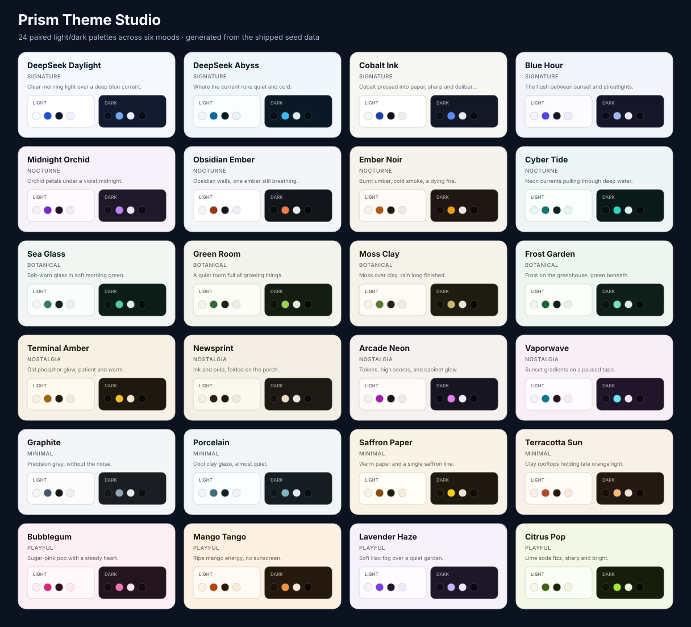

# Prism Theme Studio

<p align="center">
  
</p>

<p align="center">
  <strong>Twenty-four hand-tuned palettes for the DeepSeek Harness Web UI.</strong><br>
  Six moods, paired light and dark halves, custom accents, and a studio built for browsing.
</p>

<p align="center">
  <a href="https://github.com/elalamiimed/dsh-prism-themes/actions/workflows/ci.yml"></a>
  <a href="LICENSE"></a>
</p>

Prism is a DSH bundle that adds a **Prism Themes** page to Settings. Pick a palette and the
whole harness changes instantly — conversation, sidebar, composer, menus, code blocks,
scrollbars, and state colors. Every theme is designed twice: once for light, once for dark,
so switching the harness scheme never leaves you with a half-finished look.

---

## Highlights

- **24 curated themes** across six families: Signature, Nocturne, Botanical, Nostalgia,
  Minimal, and Playful.
- **True light/dark twins** — each theme renders a deliberately different dark palette, not
  a mechanical inversion.
- **Instant apply** through the public `ctx.theme.overrideTokens` extension point. No DOM
  surgery, no stylesheet hacks.
- **Palette mode control** for Light, Dark, or System without leaving the studio.
- **Accent character** — Calm, Signature, or Electric changes how the accent behaves.
- **Accent override** — pick any color and Prism keeps the accent legible on both surfaces.
- **Favorites and search** — filter by mood, family, or the themes you starred.
- **Surprise me** — a one-click shuffle through the catalog.
- **Export** — download the active palette and its expanded host tokens as JSON.
- **Native restore** — one button returns the harness to its original theme.
- **Browser-local and quiet** — theme, accent, and favorites live in `localStorage`; the plugin
  makes no network calls and emits no telemetry. The only host setting it writes is the stock
  Light/Dark/System preference when you click it.

## Install

Prism is distributed from this repository as a DSH bundle. Pick either route.

### Ask your DSH agent (recommended)

Clone the repository somewhere stable:

```sh
git clone https://github.com/elalamiimed/dsh-prism-themes.git ~/src/dsh-prism-themes
```

Then ask your DSH agent:

> Install the DSH bundle at `~/src/dsh-prism-themes`.

The agent uses the Harness `plugin_manager` install action against the checkout. A new bundle
normally activates through hot reload; a page refresh is safe and expected when the browser
artifact changes.

### Manual / development install

From your DSH profile, install the checkout as a linked bundle with the Harness plugin
manager's `install_bundle` action and this absolute directory as the target. Do not copy files
into the DSH installation or edit profile files by hand: the plugin manager owns package
installation, bundle selection, and HMR.

After installation, open **Settings → Prism Themes**.

## Use

1. Open **Settings → Prism Themes**.
2. Choose a palette card. It applies immediately in the current scheme.
3. Use **Palette mode** to switch between Light, Dark, and System.
4. Use **Accent character** to soften, preserve, or electrify the accent.
5. Use **Accent override** for a custom accent; **Reset** returns to the curated accent.
6. Star favorites, search by name or mood, or hit **Surprise me**.
7. Click **Native theme** to return to the stock DeepSeek Harness look.

Prism remembers the active theme, character, accent, and favorites in the current browser.
Uninstalling or disabling the bundle removes its token layer and restores the native theme.

## Theme catalog



### Signature

| Theme | Tagline | Light seeds | Dark seeds |
| --- | --- | --- | --- |
| **DeepSeek Daylight** | Clear morning light over a deep blue current. | `#F5F8FE` `#1D4ED8` `#0B1526` | `#0A1020` `#6EA8FF` `#E8EEFA` |
| **DeepSeek Abyss** | Where the current runs quiet and cold. | `#F1F6FA` `#0369A1` `#081A24` | `#050D16` `#38BDF8` `#DCEAF5` |
| **Cobalt Ink** | Cobalt pressed into paper, sharp and deliberate. | `#F6F6F2` `#1E40AF` `#101420` | `#0B0F17` `#5B8CFF` `#E6EAF2` |
| **Blue Hour** | The hush between sunset and streetlights. | `#F3F3FB` `#4F46E5` `#14142A` | `#0C0C19` `#A5B4FC` `#E9E7F7` |

### Nocturne

| Theme | Tagline | Light seeds | Dark seeds |
| --- | --- | --- | --- |
| **Midnight Orchid** | Orchid petals under a violet midnight. | `#F7F2F9` `#7E22CE` `#1D1027` | `#130F1B` `#C084FC` `#EDE4F5` |
| **Obsidian Ember** | Obsidian walls, one ember still breathing. | `#F4F5F7` `#9A3412` `#14171D` | `#0A0B0E` `#FF7A45` `#E9EAEE` |
| **Ember Noir** | Burnt umber, cold smoke, a dying fire. | `#F6F2EC` `#B45309` `#1E1712` | `#110D0A` `#F59E0B` `#EFE6DE` |
| **Cyber Tide** | Neon currents pulling through deep water. | `#EEF6F5` `#0F766E` `#08201E` | `#050F0E` `#2DD4BF` `#D9F2EE` |

### Botanical

| Theme | Tagline | Light seeds | Dark seeds |
| --- | --- | --- | --- |
| **Sea Glass** | Salt-worn glass in soft morning green. | `#F1F6F3` `#2F7D62` `#10241D` | `#071410` `#4ECCA3` `#DDEFE8` |
| **Green Room** | A quiet room full of growing things. | `#F3F5EC` `#2F6B34` `#1B2412` | `#0D120B` `#9BCF53` `#E4EBDC` |
| **Moss Clay** | Moss over clay, rain long finished. | `#F4F2E9` `#5C7A2E` `#24211A` | `#13110A` `#C7B96A` `#EAE6D6` |
| **Frost Garden** | Frost on the greenhouse, green beneath. | `#EFF6F1` `#166534` `#0F2017` | `#081310` `#6EE7B7` `#E0EFE7` |

### Nostalgia

| Theme | Tagline | Light seeds | Dark seeds |
| --- | --- | --- | --- |
| **Terminal Amber** | Old phosphor glow, patient and warm. | `#F6F1E4` `#A16207` `#221B10` | `#100D08` `#FBBF24` `#F2E6C9` |
| **Newsprint** | Ink and pulp, folded on the porch. | `#F3EFE4` `#2B2118` `#1B1813` | `#14120F` `#E9DCC3` `#EDE7DB` |
| **Arcade Neon** | Tokens, high scores, and cabinet glow. | `#F4F1EF` `#A21CAF` `#17131A` | `#0B0A12` `#E879F9` `#F0EDF7` |
| **Vaporwave** | Sunset gradients on a paused tape. | `#F9F0F6` `#0E7490` `#24151F` | `#130C1B` `#67E8F9` `#F2E5F7` |

### Minimal

| Theme | Tagline | Light seeds | Dark seeds |
| --- | --- | --- | --- |
| **Graphite** | Precision gray, without the noise. | `#F4F5F6` `#475569` `#16181B` | `#121417` `#94A3B8` `#E6E8EB` |
| **Porcelain** | Cool clay glaze, almost quiet. | `#F2F5F7` `#3E6B7A` `#122028` | `#0E1417` `#7FB3C2` `#E2EAEE` |
| **Saffron Paper** | Warm paper and a single saffron line. | `#F8F3E6` `#854D0E` `#241E10` | `#14110A` `#FACC15` `#EFE6D2` |
| **Terracotta Sun** | Clay rooftops holding late orange light. | `#F8F1EA` `#B5482A` `#251710` | `#170F0B` `#FDBA74` `#F2E3D7` |

### Playful

| Theme | Tagline | Light seeds | Dark seeds |
| --- | --- | --- | --- |
| **Bubblegum** | Sugar-pink pop with a steady heart. | `#FDF0F5` `#DA2576` `#29141E` | `#160B13` `#F472B6` `#F7E4EE` |
| **Mango Tango** | Ripe mango energy, no sunscreen. | `#FDF1E4` `#B7410E` `#2A1809` | `#170F08` `#FB923C` `#F7E7D4` |
| **Lavender Haze** | Soft lilac fog over a quiet garden. | `#F6F2FB` `#7C3AED` `#1E1530` | `#120D1A` `#C4B5FD` `#EFE6F8` |
| **Citrus Pop** | Lime soda fizz, sharp and bright. | `#F4F8E7` `#3F6212` `#1C2409` | `#0F1306` `#A3E635` `#EDF3D8` |

## How it works

Prism is a single browser-side DSH Client module. On load it creates one palette override layer
with `ctx.theme.overrideTokens('dsh-prism-themes:palette', tokens)`. Each token is supplied as a
`{ light, dark }` pair; the Harness theme presenter picks the value for the active color scheme
and writes it to the document root. Removing the layer restores the built-in theme, so the
plugin can be disabled without cleanup work.

The expanded layer covers more than 90 `--dsw-alias-*` tokens, including surfaces, borders,
labels, brand and button fills, interactive states, code blocks, diffs, scrollbars, toasts,
tooltips, and the sidebar. The theme studio itself uses only host theme tokens, so it remains
readable in every palette and in both schemes.

No session events are written, no host settings are modified (except the stock Light/Dark/
System preference when you click those controls), and nothing leaves the browser.

## Compatibility

- DeepSeek Harness Web UI, `0.2.1-rc.2` or newer.
- Node.js 18+ for tooling.
- The plugin targets the public Client extension points `ctx.theme.overrideTokens`,
  `settings.section`, and `ctx.locale`. It imports no Harness Client package as a runtime
  dependency.

## Development

There is no build step. The browser module is `client.js`; the Host half is `index.js`.

```sh
npm test        # syntax checks plus palette, packaging, and apply tests
npm pack        # inspect the publishable file list
```

To add a theme, append a thirteen-seed palette to `THEMES` in `client.js` and run `npm test`.
The test suite enforces catalog shape, paired modes, and WCAG contrast floors for text, muted
text, accents, state colors, and accent-ink pairings. The UI expands each seed into the full
host token set at runtime.

## Privacy

Prism does not collect analytics and makes no network requests. Theme preferences are stored
only in the current browser under `dsh-prism-themes:preferences:v1`.

## License

[MIT](LICENSE) © 2026 El Alami Mohamed
